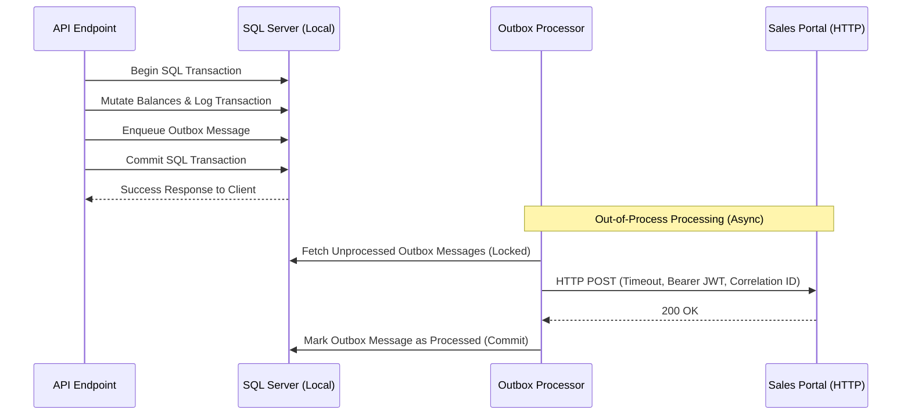

# Phase 2 Cross-Portal Delivery Strategy

This document details the architecture, reliability, and security of the out-of-process event delivery mechanism.

## 1. Architectural Strategy

## 2. Delivery & Execution Guarantees

* **Transaction Isolation**: Local database mutations (balances, ledgers, outbox messages) are committed in a single database transaction. No external HTTP calls occur within this transaction block, ensuring that network failures never cause transaction hangs or database lock leaks.
* **Asynchronous Outbox Processor**: A background service (`OutboxProcessor`) periodically queries the database for pending outbox messages, processes them, and dispatches payloads.
* **HTTP Details**:
  - Outgoing HTTP calls use `IHttpClientFactory` to prevent socket exhaustion.
  - A bounded timeout of `10 seconds` is applied per HTTP dispatch.
  - A retry policy with exponential backoff (Polly) retry is registered.
  - Bearer JWT authentication tokens are propagated to authenticate service-to-service communication.
  - Correlation IDs are forwarded in headers (`X-Correlation-Id`) to preserve traceability across boundaries.
  - Multi-instance safety is guaranteed by using an EF Core row lock/atomic update query when retrieving pending items, ensuring that a single message is processed by exactly one processor instance.
