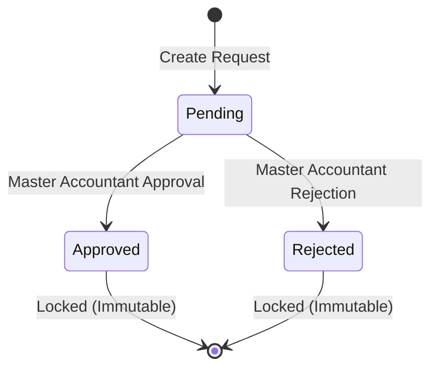

# Phase 2 State Transition Matrix

* **Document Path**: `docs/architecture/phase-2-state-transition-matrix.md`

---

## Allowed State Transitions

The core state transitions for `SupplierPayment`, `PurchaseReturn`, and `SalesReturn` are verified below:

| Source State | Target State | Triggering Action | Action Actor Role | Side-Effects |
| :--- | :--- | :--- | :--- | :--- |
| **None** | **Pending** | `CreatePayment` / `CreateReturn` | Accountant | Transaction drafted. No balances updated. |
| **None** | **Approved** | `CreatePayment` / `CreateReturn` | Master Accountant | Transaction created and instantly processed. Balances updated. |
| **Pending** | **Approved** | `ApproveTransaction` | Master Accountant | Balance updates applied. Outbox event enqueued. |
| **Pending** | **Rejected** | `RejectTransaction` | Master Accountant | Transaction closed as rejected. No balance updates. |
| **Approved** | *Any Status* | *Blocked* | *None* | **State Locked**. Immutable financial fields. |
| **Rejected** | *Any Status* | *Blocked* | *None* | **State Locked**. Immutable financial fields. |
