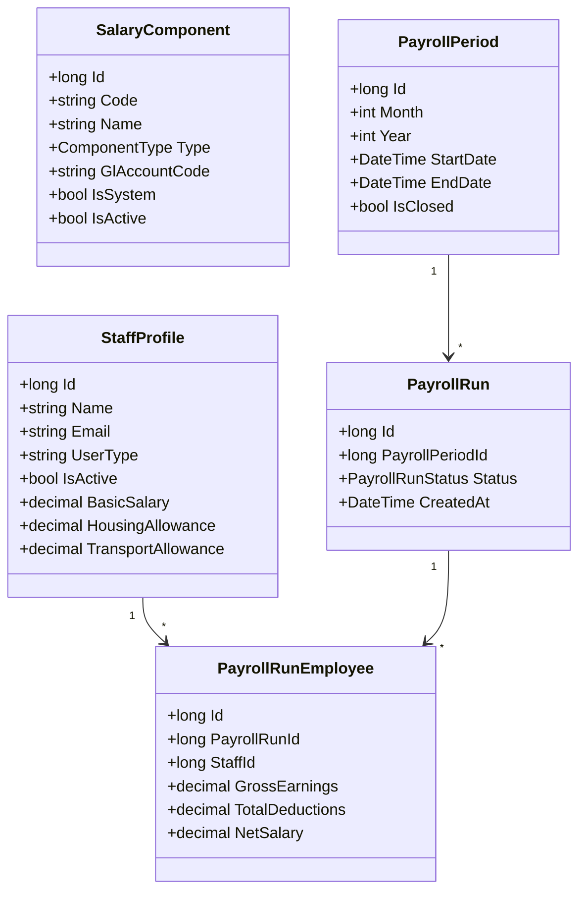

# Phase 4 — Payroll Domain Architecture

This document describes the design of the payroll domain models and their dependencies within the Texas Accounts Portal.

---

## 1. Domain Entities & Domain Layer Abstractions

The payroll domain is built on top of the Phase 3 General Ledger double-entry engine.

### 1.1 Core Entities

1. **StaffProfile**: Caches the identity of employees synced from the Operations Portal.
2. **SalaryComponent**: Represents individual earnings (e.g. Basic Salary, Commission) or deductions (e.g. Penalty, Advance recovery).
3. **StaffCompensationProfile**: Maps an employee to a custom list of salary components.
4. **PayrollPeriod**: Defines monthly intervals (independent of, but referencing, fiscal `AccountingPeriod` constraints).
5. **PayrollRun**: Represents a batch run for a specific period.
6. **PayrollRunEmployee**: Captures the calculated payslip amounts and inputs snapshot for a single employee.
7. **StaffAdvance** & **StaffLoan**: Track outstanding debts and repayments.
8. **StaffReimbursement**: Manages employee business expense reimbursement lifecycles.
9. **CommissionRecord** & **IncentiveRecord**: Records imported performance inputs from the Sales Portal.
10. **SalaryPayment**: Records actual cash/bank payments disbursing net salaries.
