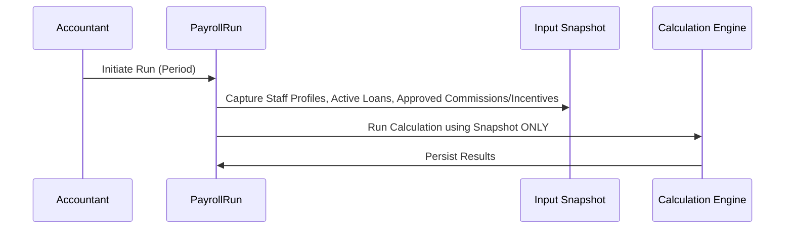

# Phase 4 — Payroll Input Snapshot Strategy

This document describes the strategy used to guarantee that payroll runs are deterministic, auditable, and isolated from dynamic remote changes.

---

## 1. The Immutability and Determinism Problem

Payroll calculations rely on inputs that change over time:
- Staff basic salary, housing, and transport allowances.
- Dynamic performance parameters (approved commissions, incentives).
- Outstanding advance balances and active loan repayments.

If these values are read live from remote or local tables during calculation, any backdated change in compensation configuration or an update to a salesman's incentive balance would retroactively change historical calculated payroll runs.

---

## 2. Snapshot Strategy

To achieve deterministic calculation, all inputs are snapshotted at the start of a Payroll Run:

### 2.1 Snapshotted Data Scope
When a `PayrollRun` is created and calculated, the system captures:
1. **Employee Profile Details**: Basic salary, allowances, active status at that instant.
2. **Approved Commissions & Incentives**: Imported commission and incentive records for that period.
3. **Advances & Loans Ledger Balance**: Outstanding advance balances and active loan repayment line schedules.
4. **Manual Adjustments**: Approved manual adjustments and deductions.

### 2.2 Persistence
Snapshots are serialized as JSON blobs or structured relational child tables (`PayrollInputSnapshot`, `PayrollRunEmployeeComponent`) associated with the `PayrollRunEmployee` record. Once calculation completes, these records are strictly immutable. Any modification to a staff member's live compensation config on the Sales Portal does not affect already-computed runs.
