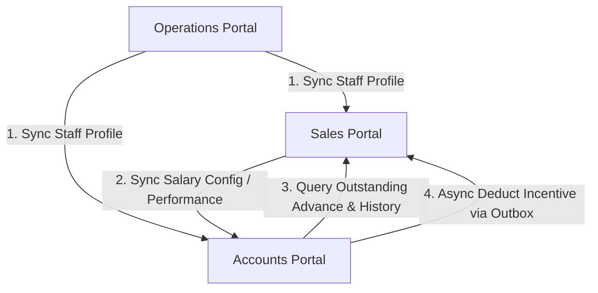

# Phase 4 — Payroll Integration Boundaries

This document defines the communication patterns, protocols, and transaction boundaries between the Accounts, Sales, and Operations Portals.

---

## 1. Integration Flows and Directions

### 1.1 Inbound Integration (Into Accounts Portal)
1. **Staff Profile Sync**:
   - **Trigger**: Profile created/modified on Operations Portal.
   - **Transport**: Secure HTTP Post (`api/public/staff/sync`).
   - **Contract**: `StaffSyncRequest`.
2. **Salary & Performance Sync**:
   - **Trigger**: Change in basic salary or monthly target reset.
   - **Transport**: Secure HTTP Post.

### 1.2 Outbound Integration (Out of Accounts Portal)
1. **Incentive Deduction**:
   - **Trigger**: Confirmed payment of incentives during payroll run approval.
   - **Transport**: Asynchronous Transactional Outbox processor executing HTTP POST to the Sales Portal API (`users/{id}/incentive`).
   - **Invariant**: Avoids synchronous HTTP client invocation within the SQL database transaction block.

---

## 2. Transaction Boundaries and Outbox Rules

1. **No External HTTP Calls Inside DB Transactions**:
   Updating external system states (such as deducting incentives from the Sales Portal) must never execute within the local SQL Server transaction block. The local transaction writes state updates and enqueues an `OutboxMessage` atomically. The background outbox processor executes the HTTP API request and marks the message as dispatched upon success.
2. **Idempotent Retry Policy**:
   All cross-portal HTTP endpoints must be idempotent. Retrying an outbox event due to network timeouts must not duplicate the transaction's financial effect.
