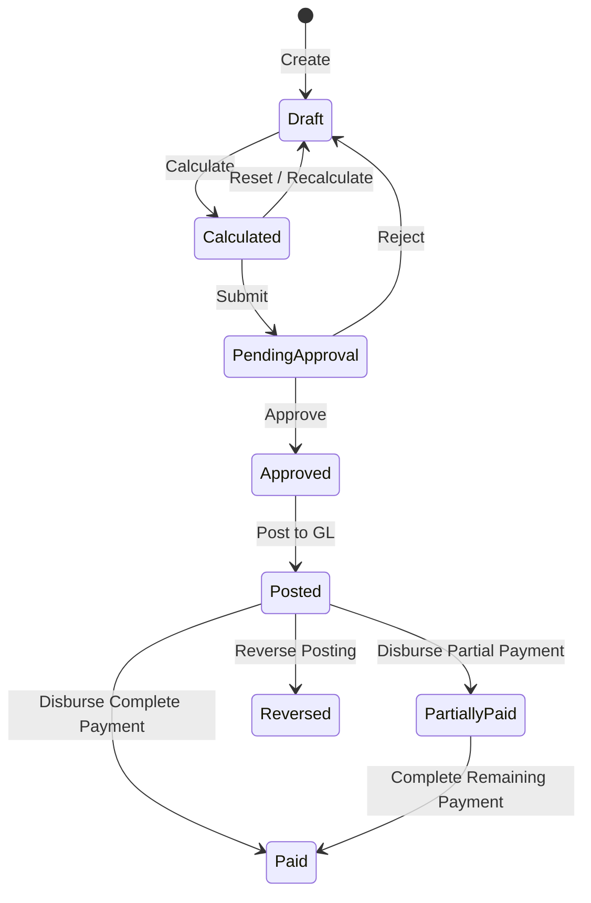
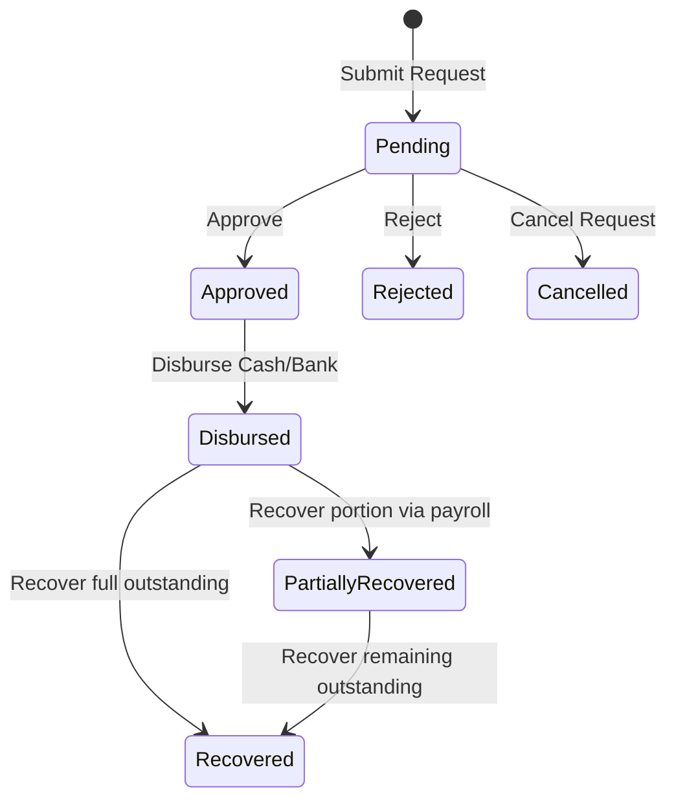
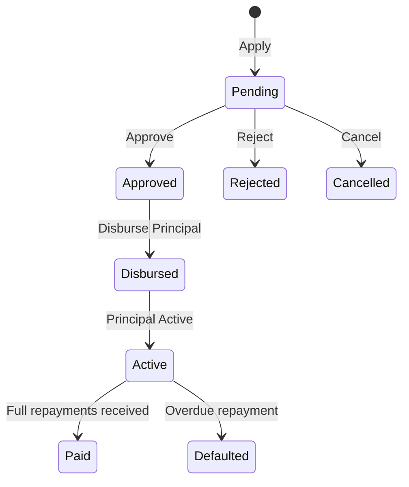
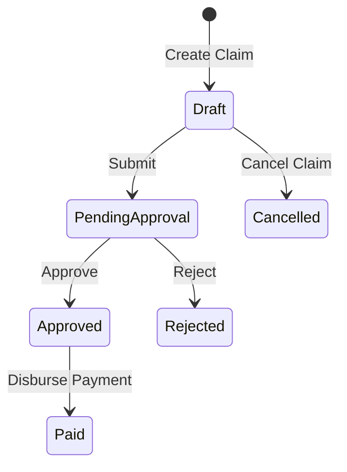

# Phase 4 — Payroll State Machines

This document specifies the allowed state transitions for Payroll Runs, Advances, Loans, and Reimbursements.

---

## 1. Payroll Run State Machine

- **Calculated**: Snapshot is locked. Recalculation reverts state to `Draft` and regenerates the snapshot.
- **Approved**: Immutable. Net Pay is locked as a payroll liability (`2115`).
- **Posted**: Balanced double-entry journals are created in the General Ledger.

---

## 2. Staff Advance State Machine

- **Disbursed**: Funds exit Cash/Bank; advance receivable balance is active.

---

## 3. Staff Loan State Machine

---

## 4. Staff Reimbursement State Machine

